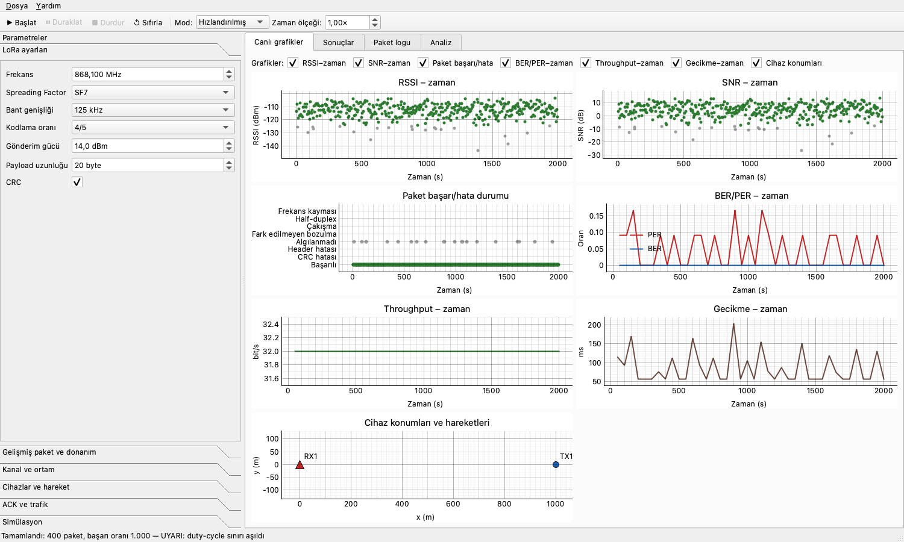
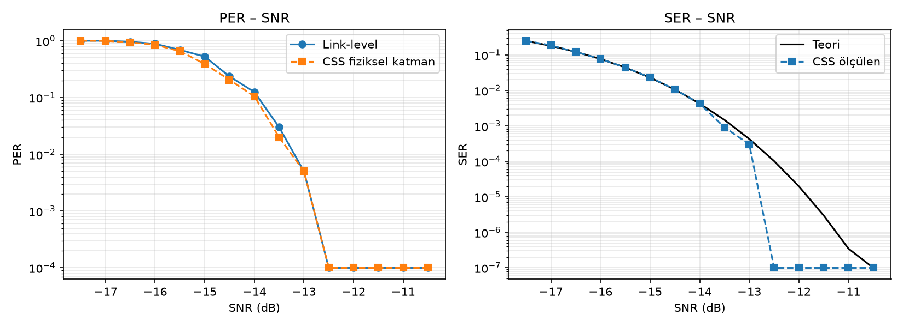
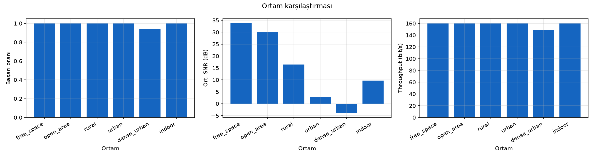

# LoRaSim — SX1276 LoRa Haberleşme Simülatörü

[](https://github.com/FatihAksoyEEE/LoRaSim/actions/workflows/tests.yml)

[](LICENSE)

LoRaSim, SX1276 tabanlı LoRa vericiler ile alıcılar arasındaki haberleşme kalitesini
bilgisayarda inceleyen bir simülatördür. PySide6 ile yazılmış bir grafik arayüzü ve komut
satırı arayüzü vardır.

> **English summary:** LoRaSim simulates link quality between Semtech SX1276 LoRa
> transmitters and receivers. It has a PySide6 GUI and a CLI, two physical-layer models (a
> fast link-level model and a full chirp-spread-spectrum waveform model, checked against
> each other), six environment profiles, fading, Doppler, interference, collisions with
> capture effect, multi-node topologies with mobility, ACK/retransmission and duty-cycle
> control. Metrics include BER/SER/PER, RSSI, SNR, throughput, latency and energy. Results
> can be exported to CSV, JSON, PNG and PDF. The UI and docs are in Turkish.



## Özellikler

- **İki fiziksel katman modeli:** hızlı **link-level** model ve gerçek chirp dalga şekli
  üreten **CSS fiziksel katman** modeli. İki modelin sonuçları birbiriyle karşılaştırılarak
  doğrulandı.
- **Kanal:** 6 ortam profili, serbest uzay ve log-distance yol kaybı, AWGN, gölgeleme,
  Rayleigh/Rician sönümleme, çok yollu yayılım, Doppler, kristal frekans kayması, harici
  girişim ve paket çakışmaları (capture effect).
- **Ağ:** birden çok verici ve alıcı, mesafe/kartezyen/rastgele yerleşim, 4 hareket modeli,
  ACK ve tekrar gönderim, duty-cycle kontrolü, half-duplex.
- **Ölçümler:** BER, SER, PER, paket kaybı, RSSI, SNR, throughput, gecikme, ACK başarısı,
  duty-cycle ihlalleri, enerji tüketimi ve başarılı haberleşme mesafesi.
- **Çıktılar:** CSV, JSON, PNG ve PDF rapor.

## Örnek çıktılar

| Link-level ↔ CSS model karşılaştırması (SF9) | Ortam karşılaştırması (2 km) |
| :---: | :---: |
|  |  |

## Kurulum

Python 3.11 veya üstü gerekir.

```bash
git clone https://github.com/FatihAksoyEEE/LoRaSim.git
cd LoRaSim
python3.11 -m venv .venv
.venv/bin/pip install -r requirements.txt
```

Paket olarak da kurulabilir. Kurulumdan sonra `lorasim` (CLI) ve `lorasim-gui` komutları
kullanılabilir:

```bash
.venv/bin/pip install -e ".[dev]"
```

## Hızlı başlangıç

```bash
# Grafik arayüzü
.venv/bin/python main.py

# Komut satırı: 20 verici, kentsel ortam, verici başına 1000 paket, hızlandırılmış mod
.venv/bin/python -m lorasim --tx-count 20 --env urban --distance 800 --packets 1000 \
    --interval 10 --mode accelerated -q --csv output/run.csv --report output/run.pdf

# Ortam karşılaştırması ve başarılı haberleşme mesafesi
.venv/bin/python -m lorasim --sweep environment --distance 2000 --png output/ortam.png
.venv/bin/python -m lorasim --max-range 0.9 --env rural --sf 10

# Link-level ↔ CSS model karşılaştırması
.venv/bin/python -m lorasim --compare-models --sf 9 --png output/modeller.png
```

Tüm seçenekleri görmek için: `python -m lorasim --help`. Ayrıntılı kullanım kılavuzu
[`docs/KULLANIM.md`](docs/KULLANIM.md) dosyasındadır.

## Testler

```bash
.venv/bin/python -m pytest
```

Test paketinde 270'ten fazla test var. Kapsadıkları:

- yapılandırma doğrulaması ve CRC
- airtime ve hassasiyet hesapları
- SER modelinin Monte Carlo ile doğrulanması
- kanal etkileri
- çoklu cihaz ve çakışma davranışı
- ACK ve duty-cycle mantığı
- CSS modülasyonu ve CSS ↔ link-level uyumu
- uzun süreli kararlılık
- dışa aktarma ve arayüz
- [`plan.md`](plan.md) §14'teki başarı kriterleri ([`tests/test_success_criteria.py`](tests/test_success_criteria.py))

Testler her push ve pull request'te GitHub Actions üzerinde Python 3.11 ve 3.12 ile çalışır.

## Proje yapısı

```text
main.py                  Arayüz (argümansız) veya CLI (argümanlı) giriş noktası
lorasim/
├── cli.py               Komut satırı
├── config.py            Yapılandırma sınıfları, doğrulama, JSON
├── lora/                SX1276 sabitleri, airtime, hassasiyet, SER, CRC, CSS mod/demod
├── channel/             Yol kaybı, ortamlar, sönümleme, Doppler, girişim, link modeli
├── devices/             Cihazlar, hareket modelleri, verici/alıcı durumu
├── simulation/          Olay zamanlayıcı, motor, link-level ve CSS modelleri, ACK, duty-cycle, analiz
├── metrics/             Metrik toplayıcı, zaman serileri, enerji
├── export/              CSV, JSON, PNG/PDF rapor
├── gui/                 PySide6 arayüzü
└── config/default_config.json
tests/                   pytest test paketi
docs/KULLANIM.md         Kullanım kılavuzu
plan.md                  Gereksinimler, tasarım kararları ve başarı kriterleri
todo.md                  Sürüm bazlı ilerleme listesi
```

## Lisans

Bu proje [MIT Lisansı](LICENSE) ile dağıtılmaktadır.

## Geliştirici

**Mehmet Fatih Aksoy** · [@FatihAksoyEEE](https://github.com/FatihAksoyEEE)

Hata bildirimi ve önerileri [Issues](https://github.com/FatihAksoyEEE/LoRaSim/issues)
sayfasından iletebilirsiniz.
